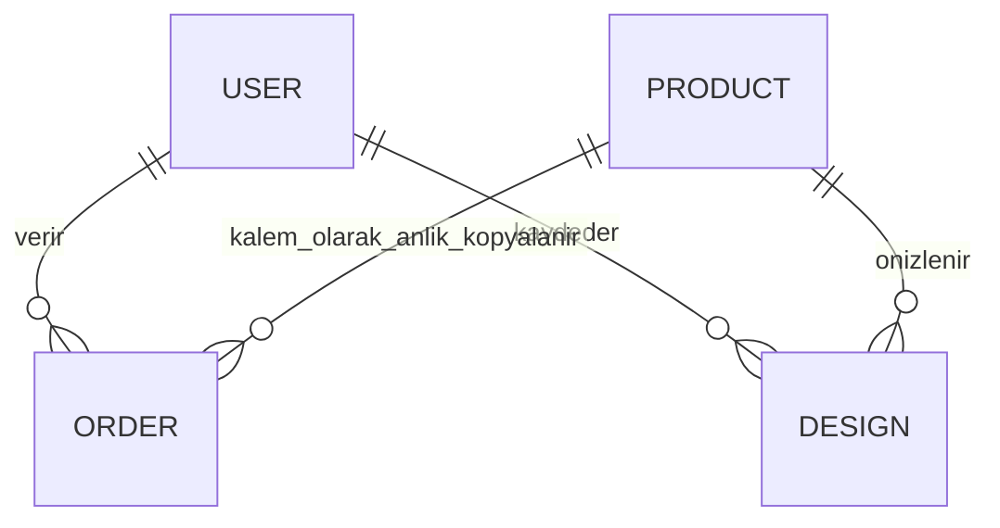

# Kodu anlama ve sunum rehberi

## Katmanlar

- `server/db.js`: Mongoose şemaları ve MongoDB bağlantısı.
- `server/app.js`: HTTP uçları, oturum ve rol kontrolü, fiyat/stock/ödeme mantığı.
- `server/index.js`: MongoDB bağlantısı, örnek ürünler, geliştirmede Vite ve üretimde statik dosyalar.
- `server/create-admin.js`: yalnızca yerel yetkili terminalden ilk süper admin.
- `src/main.jsx`: React katalog, üyelik, sepet, sipariş ve yönetim ekranları.
- `src/Studio.jsx`: Three.js sahnesi, geometri, kamera, sürükleme, boyut ve dönüş. Fotoğraf `blob:` adresiyle tarayıcıda tutulur.
- `tests/api.test.js`: gerçek MongoDB ile API entegrasyonları.
- `tests/browser.spec.js`: gerçek Chromium ile görünüm ve 3D etkileşimi.

## Sipariş nasıl çalışır?

1. Tarayıcı yalnızca ürün kimliği ve adedi yollar; fiyatı belirleyemez.
2. API giriş oturumunu ve adresi kontrol eder.
3. Ürün fiyatlarını MongoDB'den okur; toplamı hesaplar.
4. `stock >= quantity` koşullu atomik güncellemeyle stok ayırır. Çok ürünlü rezervasyonda hata olursa daha önce ayrılan stoklar geri eklenir.
5. Sipariş `pending` olarak saklanır; demo ödeme açıkça `demo_paid` olur.
6. iyzico varsa checkout form başlatılır. Ödeme dönüşü tek başına güvenilmez; API sağlayıcının `retrieve` servisini sorgular.

Rolü frontendde bir düğmeyi gizlemek güvenlik sağlamaz. `roles()` kullanıcının güncel rolünü veritabanından kontrol eder. Üyelik isteğindeki `role` alanı kullanılmaz. Kullanıcı sipariş sorgusu kendi oturum kimliğiyle sınırlandırılır.

## Veri modeli

Sipariş kalemleri ürünün sipariş anındaki adını ve fiyatını içerir; sonradan fiyat düzenlemek geçmiş siparişi değiştirmez.

## Canlı kodlama hazırlığı

- Yeni kategori: sunucu `validProduct` izinli kategorileri, admin form seçenekleri ve katalog filtreleri birlikte düzenlenir.
- Yeni ürün alanı: şema → API doğrulama/izinli alan listesi → admin form → ürün kartı → anlamlı test.
- Fiyat filtresi: React ürün dizisini filtrele; API üzerinden gelen fiyatları kullan.
- Rol ekleme: User enum, rol kontrolü ve rol seçim arayüzü; yetkisiz istek testini güncelle.
- 3D modeli değiştir: Studio içindeki `box()` çağrıları ve kategoriye göre ölçüler. Gerçek model için güvenilir GLB ve yükleme hatası yönetimi ekle.

Bir değişikliği neden yaptığını, hangi katmanda kontrol edildiğini ve nasıl test edildiğini kendi cümlelerinle açıklayabilmelisin. README'yi ezberlemek kod hakimiyeti yerine geçmez.
